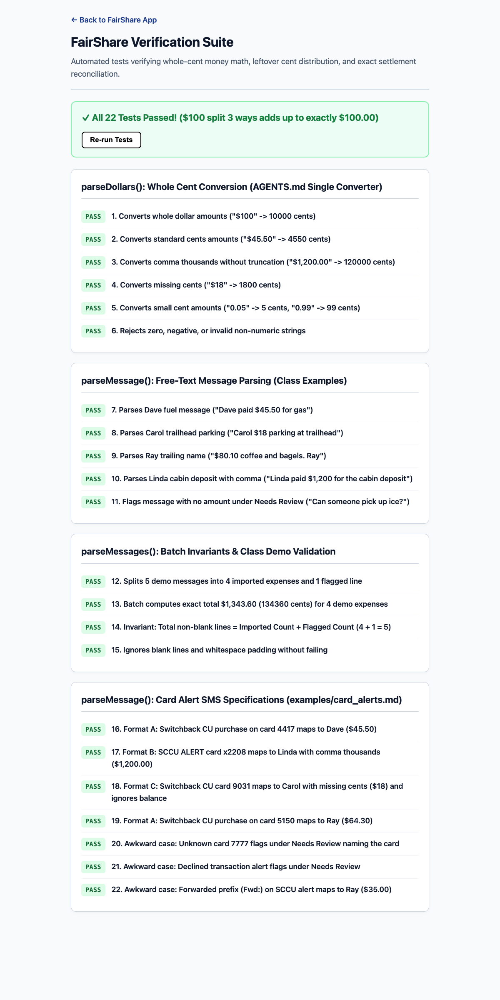
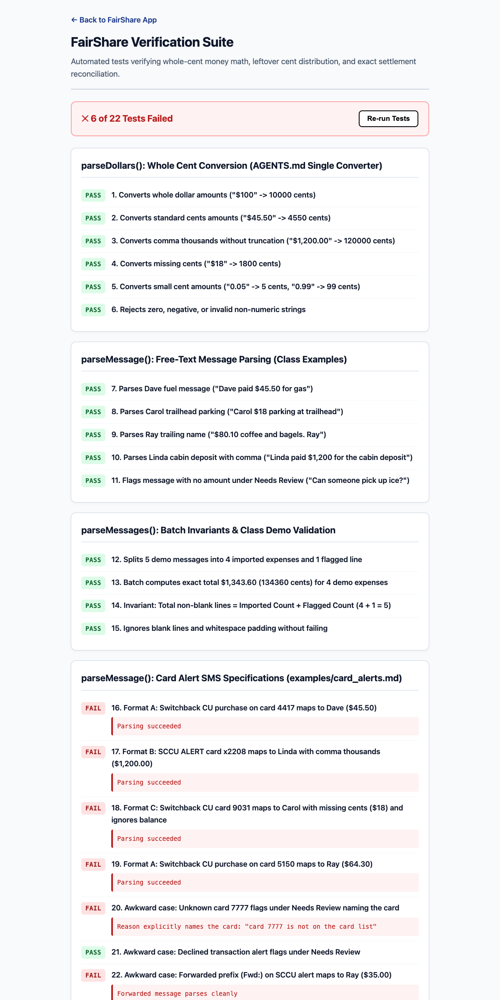
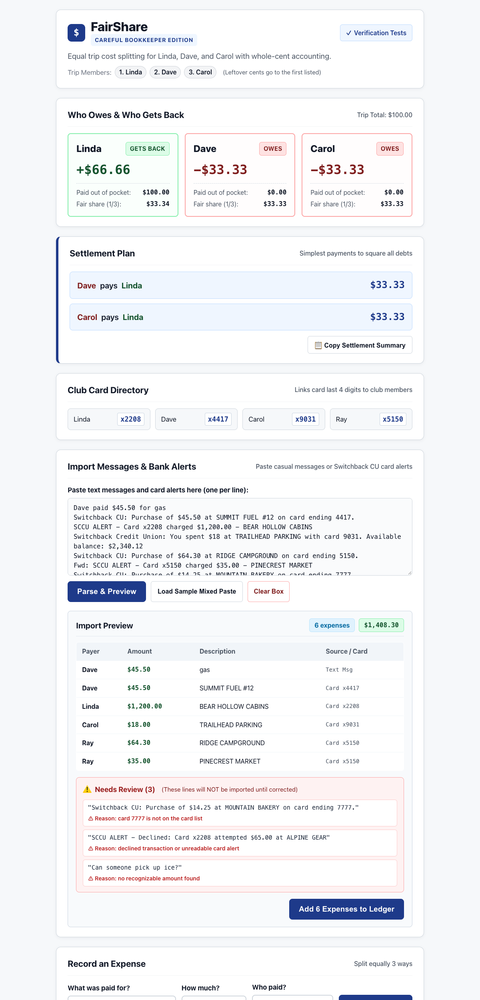

# FairShare User Guide & Verification Walkthrough

Welcome to **FairShare** (Careful Bookkeeper Edition). FairShare is a zero-dependency, whole-cent expense sharing and settlement web application designed to eliminate rounding errors, pennies lost to division, and manual data-entry chores when reconciling group expenses.

This guide provides step-by-step instructions on running FairShare, using the **Treasurer's Inbox** (automated bank alert and SMS parser), and running the automated test suite.

---

## 1. Quick Start: How to Run FairShare

FairShare is built exclusively in standards-compliant HTML5, Vanilla CSS, and modern JavaScript. It requires **no server installations, no npm packages, and no build pipeline**.

### Method 1: Direct Browser Launch (Recommended)
Simply navigate to the project directory in your file manager (Finder on macOS, Explorer on Windows) and **double-click** either file:
- **`index.html`** &rarr; Launches the FairShare Expense Sharing Application.
- **`tests.html`** &rarr; Launches the Automated Verification Test Suite.

### Method 2: Local HTTP Server (Optional)
If you prefer running through a local development server:
```bash
# Using Python 3 built-in HTTP server:
cd /path/to/FairShare
python3 -m http.server 8080

# Then open in your browser:
# http://localhost:8080/index.html
# http://localhost:8080/tests.html
```

Or using Node's `npx serve`:
```bash
npx -y serve .
```

---

## 2. The Verification Suite (Tests)

FairShare includes a built-in verification suite covering money mathematics, leftover cent distribution, currency formatting, text message parsing, bank alert formats, and awkward input cases.

### Running in the Browser (`tests.html`)
Open [`tests.html`](./tests.html) in any modern browser. The suite runs automatically on page load and displays a clear pass/fail status banner:


*Figure 1: All 22 tests passing in `tests.html` (15 baseline tests + 7 card alert tests).*

### Running in the Terminal via Node.js
You can also run the complete test suite directly from your shell without opening a browser:
```bash
node tests.js
```

**Expected Terminal Output:**
```text
Running Tests in tests.js...

--- parseDollars(): Whole Cent Conversion (AGENTS.md Single Converter) ---
  [PASS] 1. Converts whole dollar amounts ("$100" -> 10000 cents)
  [PASS] 2. Converts standard cents amounts ("$45.50" -> 4550 cents)
  [PASS] 3. Converts comma thousands without truncation ("$1,200.00" -> 120000 cents)
  [PASS] 4. Converts missing cents ("$18" -> 1800 cents)
  [PASS] 5. Converts small cent amounts ("0.05" -> 5 cents, "0.99" -> 99 cents)
  [PASS] 6. Rejects zero, negative, or invalid non-numeric strings
--- parseMessage(): Free-Text Message Parsing (Class Examples) ---
  [PASS] 7. Parses Dave fuel message ("Dave paid $45.50 for gas")
  [PASS] 8. Parses Carol trailhead parking ("Carol $18 parking at trailhead")
  [PASS] 9. Parses Ray trailing name ("$80.10 coffee and bagels. Ray")
  [PASS] 10. Parses Linda cabin deposit with comma ("Linda paid $1,200 for the cabin deposit")
  [PASS] 11. Flags message with no amount under Needs Review ("Can someone pick up ice?")
--- parseMessages(): Batch Invariants & Class Demo Validation ---
  [PASS] 12. Splits 5 demo messages into 4 imported expenses and 1 flagged line
  [PASS] 13. Batch computes exact total $1,343.60 (134360 cents) for 4 demo expenses
  [PASS] 14. Invariant: Total non-blank lines = Imported Count + Flagged Count (4 + 1 = 5)
  [PASS] 15. Ignores blank lines and whitespace padding without failing
--- parseMessage(): Card Alert SMS Specifications (examples/card_alerts.md) ---
  [PASS] 16. Format A: Switchback CU purchase on card 4417 maps to Dave ($45.50)
  [PASS] 17. Format B: SCCU ALERT card x2208 maps to Linda with comma thousands ($1,200.00)
  [PASS] 18. Format C: Switchback CU card 9031 maps to Carol with missing cents ($18) and ignores balance
  [PASS] 19. Format A: Switchback CU purchase on card 5150 maps to Ray ($64.30)
  [PASS] 20. Awkward case: Unknown card 7777 flags under Needs Review naming the card
  [PASS] 21. Awkward case: Declined transaction alert flags under Needs Review
  [PASS] 22. Awkward case: Forwarded prefix (Fwd:) on SCCU alert maps to Ray ($35.00)

Result: 22 passed, 0 failed.
```

### The TDD "Red-to-Green" Discipline
Per Session 2 instructions, tests were added before implementation code. The screenshot below preserves the initial test run showing the 6 new card alert checks failing before `importer.js` was modified:


*Figure 2: Test-Driven Development (TDD) red checkpoint: new card alert specifications failing prior to code implementation.*

---

## 3. The Treasurer's Inbox: Importing Bank Alerts & SMS

Instead of manually typing every receipt, the Treasurer can paste raw bank alerts directly from text messages or emails into the import box.

### Club Card Directory
Automated card alerts do not state a person's name—only the last 4 digits of the card. FairShare maintains a card directory mapping card endings to club members:

| Member | Card Ending | Fictional Bank / Credit Union |
|---|:---:|---|
| **Linda** | `2208` | Switchback Community CU (SCCU) |
| **Dave** | `4417` | Switchback Community CU (SCCU) |
| **Carol** | `9031` | Switchback Community CU (SCCU) |
| **Ray** | `5150` | Switchback Community CU (SCCU) |

### Supported Alert Formats
1. **Format A:**
   ```text
   Switchback CU: Purchase of $45.50 at SUMMIT FUEL #12 on card ending 4417.
   ```
   &rarr; **Dave**, `$45.50` (`4550¢`), Description: `SUMMIT FUEL #12`
2. **Format B:**
   ```text
   SCCU ALERT - Card x2208 charged $1,200.00 - BEAR HOLLOW CABINS
   ```
   &rarr; **Linda**, `$1,200.00` (`120000¢`), Description: `BEAR HOLLOW CABINS`
3. **Format C:**
   ```text
   Switchback Credit Union: You spent $18 at TRAILHEAD PARKING with card 9031. Available balance: $2,340.12
   ```
   &rarr; **Carol**, `$18.00` (`1800¢`), Description: `TRAILHEAD PARKING`

### How to Use the Live Importer
1. Open [`index.html`](./index.html).
2. Scroll to the **"Import Messages & Bank Alerts"** section.
3. Click **"Load Sample Mixed Paste"** (or paste your own batch of text messages and credit union alerts).
4. Click **"Parse & Preview"**.
5. Examine the **Import Preview**:
   - The **Count and Total badges** show valid items and total dollar sum.
   - The **Preview Table** shows the detected payer, exact amount, cleaned description, and card origin.
   - The **"Needs Review" Box** highlights lines that require manual attention.
6. Click **"Add Expenses to Ledger"** to commit them into the active trip balance.


*Figure 3: Live import preview with mixed paste, expense breakdown, and the high-contrast Needs Review warning box.*

### Awkward Cases Handled Correctly
- **Comma Thousands:** Amounts with thousands separators like `$1,200.00` parse to `120000` integer cents without truncation.
- **Missing Cents:** Integer dollar figures like `$18` parse cleanly to `1800` cents.
- **Secondary Balance Ignored:** In Format C messages containing `"Available balance: $2,340.12"`, FairShare extracts only the purchase amount (`$18.00`) and ignores the account balance.
- **Unknown Card Ending:** If an alert comes from an unlisted card (e.g. `card ending 7777`), it is routed to "Needs review" with the explicit message:
  ```text
  ⚠ Reason: card 7777 is not on the card list
  ```
- **Declined Alerts:** Transactions marked as `Declined` or `attempted` are flagged for review.
- **Forwarded Prefixes:** Automated email/SMS prefixes like `"Fwd:"` or `"FWD:"` are stripped cleanly before parsing.
- **Non-Silent Drop Invariant:** Every non-blank line submitted is either successfully imported or flagged under Needs Review (`Total Lines = Imported + Needs Review`).

---

## 4. How FairShare Splits Expenses & Settles Debts

FairShare operates on the **Careful Bookkeeper Principle**:
1. **Integer Arithmetic:** Every dollar amount is converted immediately into whole integer cents (`parseDollars()`). Floating-point approximations are never used.
2. **Leftover Cent Distribution:** When an expense cannot be divided evenly into 3 integer cents (for example, a **$100.00** dinner is 10,000 cents &divide; 3 = 3,333 cents with **1 leftover cent**), the leftover cent is assigned to members in strict roster order:
   - **Linda:** $33.34 (3,334¢)
   - **Dave:** $33.33 (3,333¢)
   - **Carol:** $33.33 (3,333¢)
   - **Total:** Exactly $100.00 (10,000¢)
3. **Net Balances ("Who Owes & Who Gets Back"):**
   - If Linda paid $100.00 out of pocket, she paid $100.00 and her share is $33.34. She **gets back $66.66**.
   - Dave and Carol each paid $0.00 and their share is $33.33. Each **owes $33.33**.
4. **Optimal Settlement Plan:**
   - Dave pays Linda $33.33.
   - Carol pays Linda $33.33.
   - All balances are settled with the minimal number of direct transfers.
5. **Copy Settlement Button:** Click **"📋 Copy Settlement Summary"** to generate a pre-formatted message ready to paste into your group chat.

---

## 5. File Inventory

```text
FairShare/
├── index.html            # Main web application UI
├── style.css             # High-contrast CSS styles and responsive layout
├── app.js                # Application state and DOM event controllers
├── money.js              # Pure money arithmetic and settlement optimizer
├── importer.js           # Text message and bank alert parsing engine
├── tests.html            # Browser test runner page
├── tests.js              # 22 automated test checks (Node.js & browser compatible)
├── AGENTS.md             # AI standing orders and card directory rules
├── README.md             # Project overview and AI-use disclosures
├── USER_GUIDE.md         # This comprehensive user guide
├── PROMPTS.md            # Exact record of all development prompts
├── sample_alerts.txt     # Fictional mixed paste test lines
├── memory_check.md       # New-conversation rule compliance proof
├── git_log.txt           # Linear git commit history
├── tests_red.png         # Screenshot of initial failing tests
├── tests_green.png       # Screenshot of all 22 passing tests
└── import_preview.png    # Screenshot of live preview and Needs Review box
```
